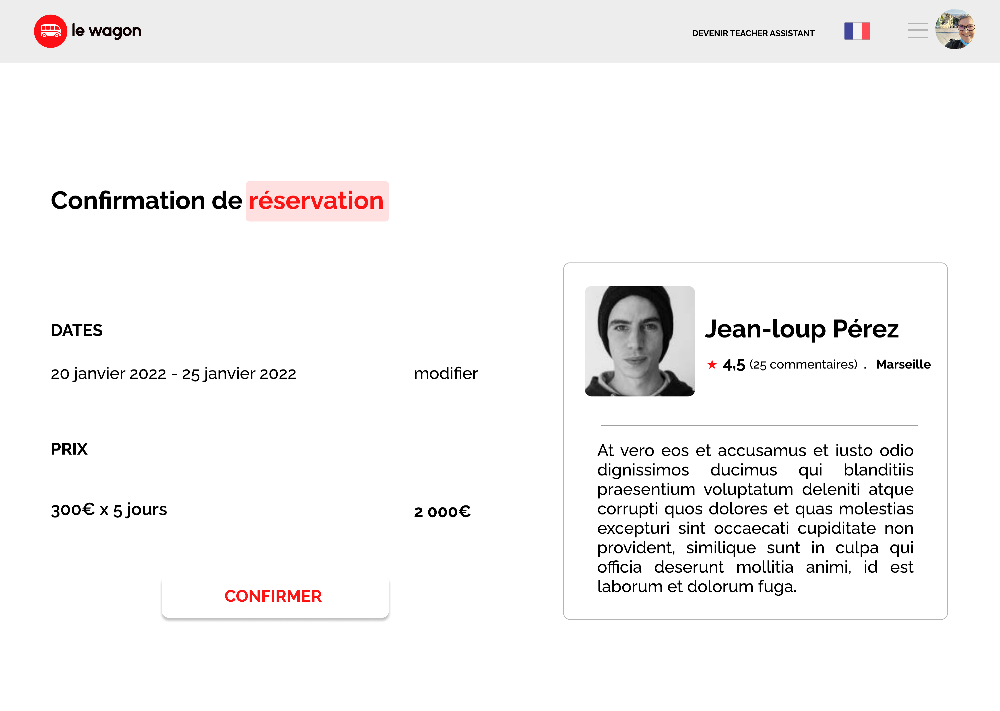
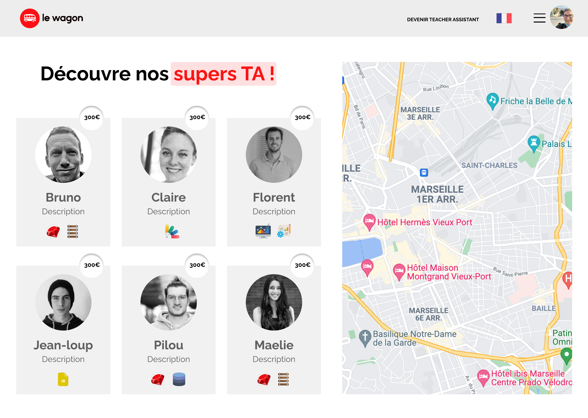
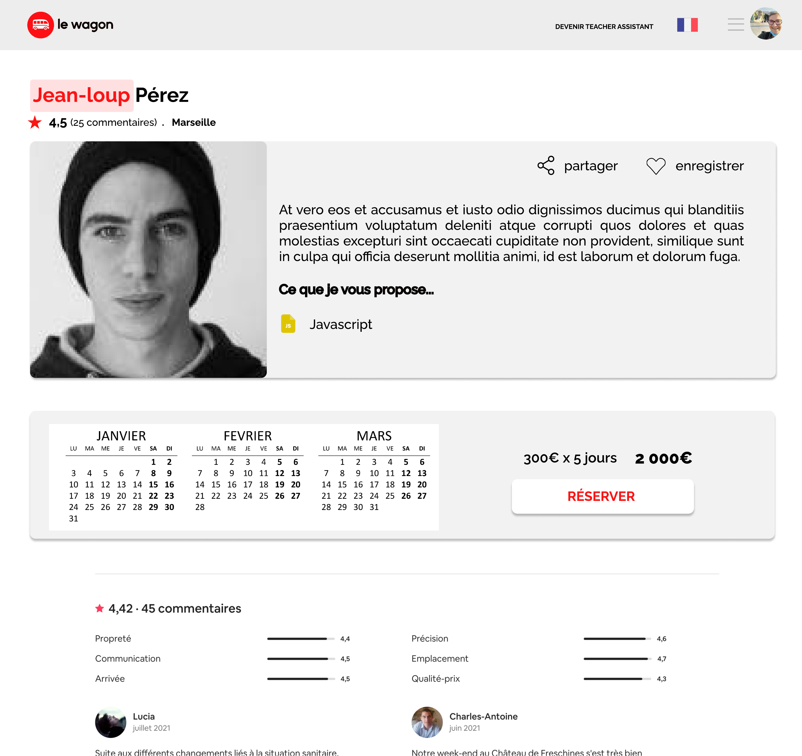
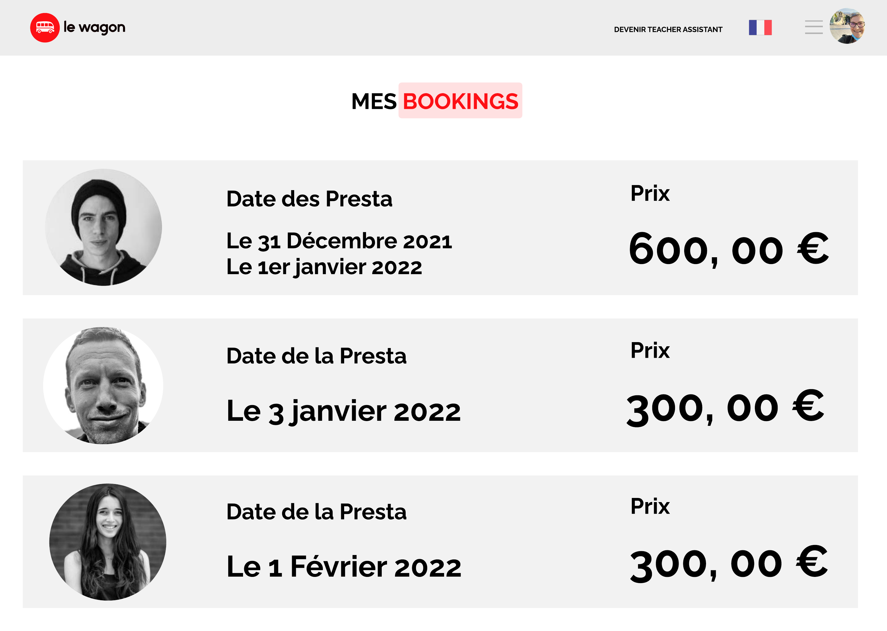
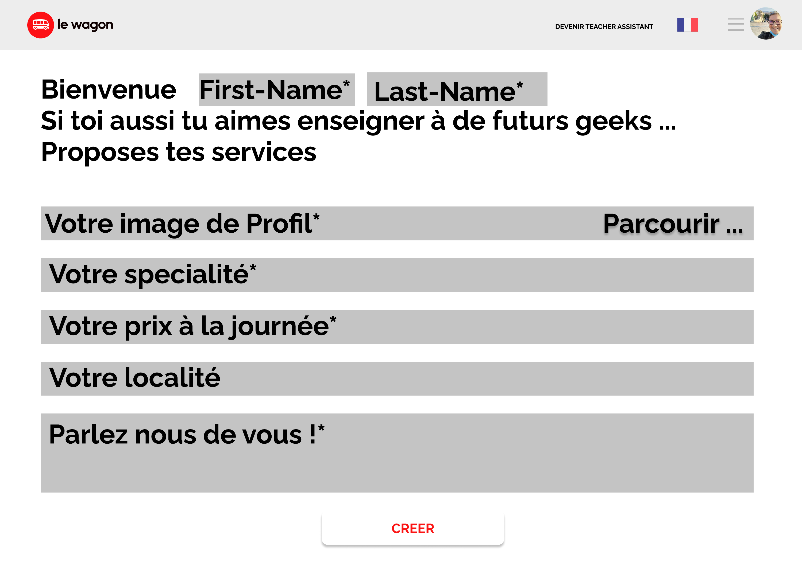
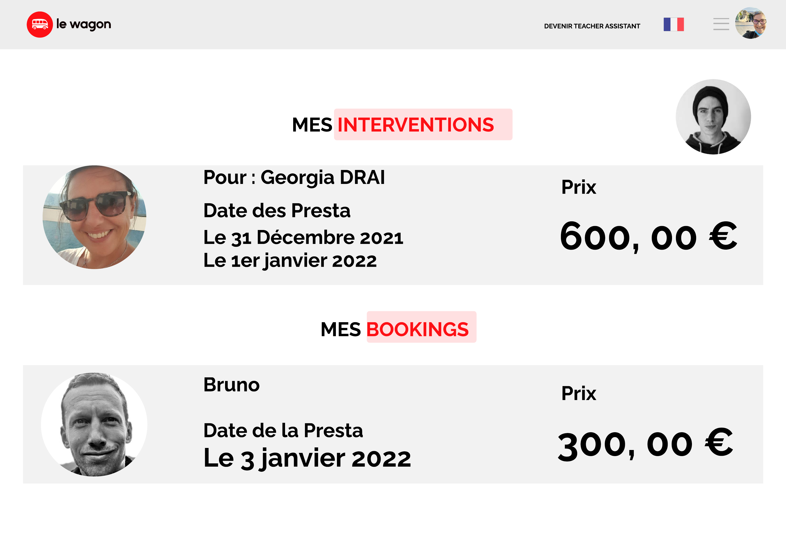

<h1 align="center">📚 BOOK_YOUR_TA – Le AirBnB des profs débordés 👨‍🏫</h1>

  Projet full-stack conçu au <strong>bootcamp Le Wagon – Batch #776</strong> 
  💥 Quand t’as 3 tickets ouverts, 2 bugs critiques et 0 TA dispo...

---

## 🤯 Le pitch

BOOK_YOUR_TA, c’est l’application que notre batch aurait rêvé d’avoir pour survivre aux journées d’autonomie.  
Une marketplace de Teacher Assistants (TAs) pour booker de l’aide quand tu croules sous les bugs et les merges qui pètent 😅

---

## ✨ Fonctionnalités

- 🔍 Recherche de TAs par ville et spécialité
- 🗓 Réservation avec calendrier interactif
- 👤 Fiches profil claires avec spécialités, tarifs, et avatar
- 💬 Commentaires post-presta
- 📷 Upload de photos via Cloudinary
- 🔐 Authentification et rôles (user / TA)

---

## 🛠️ Stack technique

- ⚙️ **Ruby on Rails** – MVC, ActiveRecord & Devise
- 🧠 **PostgreSQL** – pour gérer les users, bookings & TA
- 🌐 **Bootstrap** – responsive et rapide à intégrer
- ☁️ **Cloudinary** – stockage des avatars
- 📦 **Yarn / Webpack** – gestion des assets
- 🧪 **Rspec** (en cours) – pour des tests automatisés futurs

---

## 👩‍💻 Mon rôle

> Lead back-end développeuse aka bug chasseresse officielle 🐛

- Architecture MVC (models/controllers/routes/views)
- Gestion des relations (User ↔ Bookings ↔ TA)
- Intégration Devise pour les rôles & authentification
- Collaboration avec le front pour fluidifier les données & l’UX

---

## 📸 Aperçu
Notre interface a été pensée pour offrir une expérience simple, fluide et amusante.  

---

### 🏠 Page d’accueil – Recherche par spécialité et ville

---

### 📅 Page de confirmation de réservation

---

### 👩‍🏫 Liste des TAs disponibles + carte interactive

---

### 📋 Profil d’un TA avec calendrier, compétences et tarif

---

### 🙋 Espace utilisateur – Mes réservations

---

### ✍️ Formulaire d’inscription – Devenir TA

---

### 🧾 Espace TA – Mes interventions passées

---

> 🧠 Cette maquette a été conçue pour **s’inspirer du fonctionnement d’Airbnb**, adaptée avec humour à notre réalité du Wagon : des tickets, des bugs, et beaucoup d’entraide.

## 🤝 L’équipe du chaos organisé

Projet réalisé en **2 à 3 semaines intensives**, dans une ambiance studieuse et joyeusement chaotique 🎢

| Nom & Avatar | Rôle |
|-------------|------|
|  [**Lilia Bekrar**](https://github.com/LiliaBekrar) | Lead développeuse back-end 🛠️ |
|  [**Maewenn Drean**](https://github.com/mdrean) | Lead développeuse front-end 🎨 |
|  [**Isabelle Douin**](https://github.com/IsaDou) | Développeuse back-end 🔧 |
|  [**Georgia Drai**](https://github.com/lumlum08) | Développeuse front-end 🎨 |
---

## 🤓 À propos

Projet du bootcamp [Le Wagon](https://www.lewagon.com), batch #776.  
Pensé pour rire, codé pour apprendre, livré avec fierté 💡

---

  Fabriqué avec ❤️, beaucoup de rires, et un soupçon de débrouillardise ✨

